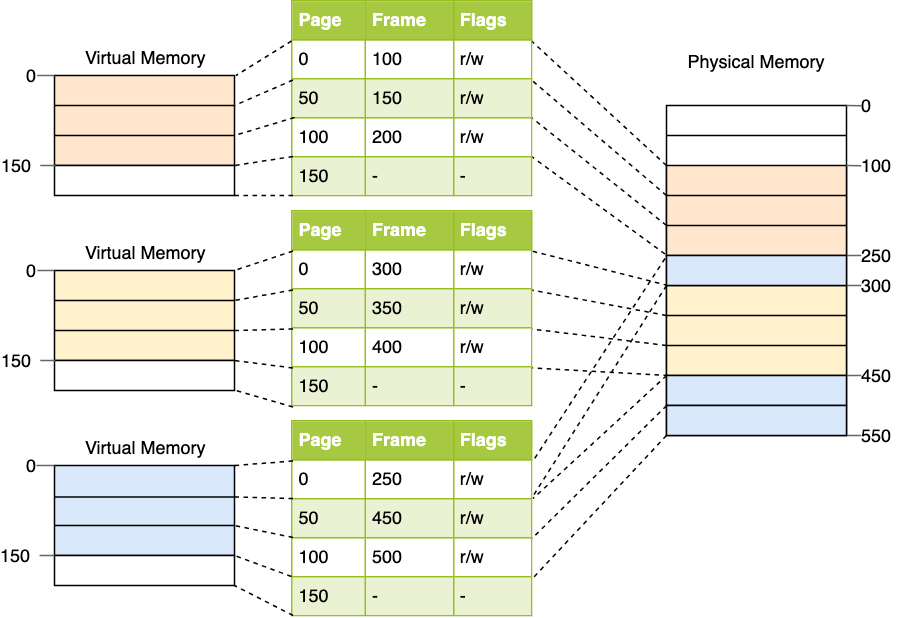
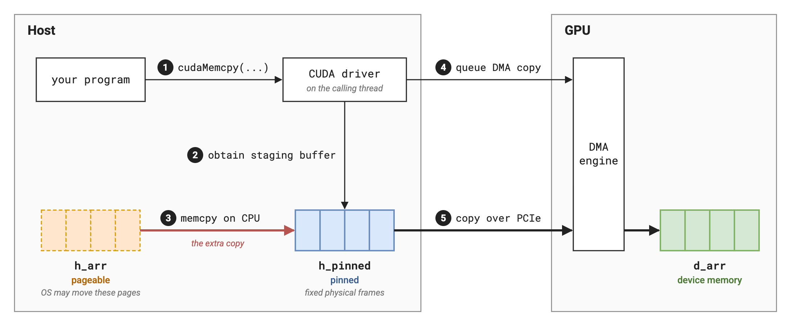
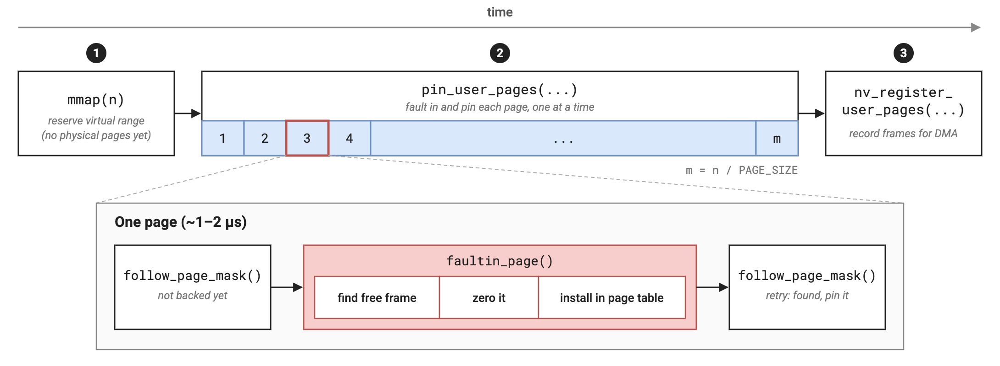

This writeup was motivated by [cudf#23457](https://github.com/rapidsai/cudf/pull/23457), an optimization I made for pinned memory initialization times in [cuDF](https://docs.rapids.ai/api/cudf/stable/). In the process, I had the anomalous experience of legitimately needing to read Linux kernel source, which naturally led to some fun and abstruse learnings.

# 1) Pinned Memory: Who Cares?

## Memory Basics

From a program's point of view, memory looks like a continuous sequence of addresses. We request an arbitrary chunk of memory with `malloc(n)`, and the allocator gives us a buffer of `n` continuous memory addresses, each pointing to a byte.

```cpp
unsigned char *p = malloc(5);
for (int i = 0; i < 5; ++i) printf((void *)(p))
// 0x1011fdba0 0x1011fdba1 0x1011fdba2 0x1011fdba3 0x1011fdba4
```

As one learns in an operating systems course, these are just *virtual addresses*, and their continuity is an illusion created by the OS. Beneath this virtual address space, the operating system considers memory as a sequence of fixed-size chunks called *pages*. These virtual pages are mapped to *physical page frames* somewhere in RAM, which hold the actual bytes.


{caption: Virtual pages are mapped to physical page frames via page tables. ([Source](https://os.phil-opp.com/paging-introduction/)).}

This layer of indirection enables the OS to swap or migrate pages as it sees fit, without disrupting the continuity of our virtual address space.

**Pinned memory** refers to pages that are **physically fixed to a page frame in RAM**[^pinned-vs-page-locked]. In other words, pinned pages will never be swapped or migrated.

Pinned memory is *critical* for high performance GPU applications.

## Dissecting DMA

> So why does pinned memory matter for GPUs?

Invariably, working with GPUs requires transferring data between the CPU and GPU.

Every framework has its own transfer APIs (`x.to(device)` in PyTorch, `jax.device_put(x, device)` in JAX). These generally all boil down to some form of [`cudaMemcpy`](https://docs.nvidia.com/cuda/cuda-runtime-api/cuda_runtime_api/group__CUDART__MEMORY.html#group__cudart__memory_1gac263dbe6574220cc776b45438fc351e8). For instance:

```cpp
// Reserve and set some host memory.
int *h_arr = (int*)malloc(bytes);
memset(h_arr, 0, bytes);

// Reserve some device memory.
int *d_arr;
cudaMalloc((int**)&d_arr, bytes);

cudaMemcpy(d_arr, h_arr, bytes, cudaMemcpyHostToDevice);  // host -> device
foo<<<grid, block, 0>>>(d_arr);                           // do something on the GPU
cudaMemcpy(h_arr, d_arr, bytes, cudaMemcpyDeviceToHost);  // device -> host
```

This calls into the GPU's [DMA (Direct Memory Access) engine](https://en.wikipedia.org/wiki/Direct_memory_access), which initiates the copy over PCIe. As its name implies, the DMA engine needs *direct* access to physical host memory — it doesn't go through the host virtual memory system[^iommu].

Thus, the DMA engine takes a range of *physical bytes* on the host. You can imagine the problems if the host-resident bytes were in *pageable memory*, rather than pinned memory. What if we did:

```cpp
cudaMemcpy(d_arr, h_arr, bytes, cudaMemcpyHostToDevice);
  |
  DMA_COPY(dst_address=0x5678, src_address=0x1234, bytes=1000);
```

...and just after the DMA initiates the copy, the OS decides to move the page that holds `0x1234`? We'd end up reading garbage, or worse, corrupting memory.

To prevent these calamities, the host buffer *must be pinned* before a copy in either direction. The CUDA driver — running on the host[^driver-thread] — will do this for us by creating temporary, pinned staging buffers every time you make a copy. What really happens is this:

1. We call `cudaMemcpy` in the host &rarr; device direction.
2. The CUDA driver obtains a pinned staging buffer on the host.
3. The CUDA driver **copies your host buffer into the pinned staging buffer**.
4. The CUDA driver queues a DMA copy from the pinned buffer to the device.
5. The DMA engine performs the copy from pinned memory.


{caption: A host-to-device cudaMemcpy from pageable memory. Thanks Claude.}

The device-to-host direction proceeds conversely, copying our device buffer into pinned memory.

Bottom line, there is an extra copy between pageable and pinned memory happening under the hood with every `cudaMemcpy`, and the CUDA driver does it for us.

## Pinning Manually

> If the CUDA driver pins memory for me, why should I care?

The first reason is that, armed with this knowledge, we can avoid the extra copy by making pinned host allocations. Instead of an ordinary `malloc`, we simply use [`cudaHostAlloc`](https://docs.nvidia.com/cuda/cuda-runtime-api/group__CUDART__MEMORY.html#group__CUDART__MEMORY_1gb65da58f444e7230d3322b6126bb4902):

```diff
- int *h_arr = (int*)malloc(bytes);
+ int *h_arr;
+ cudaHostAlloc((void**)&h_arr, bytes, cudaHostAllocDefault);
```

`cudaHostAlloc` gives you host memory that is already pinned. `cudaMemcpy` no longer needs a temporary staging buffer.

The second reason is **asynchrony**. Imagine we want to use `cudaMemcpyAsync`, hoping to overlap the copy with other CPU work. Knowing no better, we use a plain `malloc`:

```cpp
// Reserve and set some (pageable!) host memory.
int *h_arr = (int*)malloc(bytes);
memset(h_arr, 0, bytes);

// Reserve some device memory.
int *d_arr;
cudaMalloc((int**)&d_arr, bytes);

cudaMemcpyAsync(d_arr, h_arr, bytes, cudaMemcpyHostToDevice, stream);  // host -> device
bar(); // do CPU work while we wait

foo<<<grid, block, 0, stream>>>(d_arr);  // do something on the GPU

cudaMemcpyAsync(h_arr, d_arr, bytes, cudaMemcpyDeviceToHost, stream);  // device -> host
bar();  // do CPU work while we wait

cudaStreamSynchronize(stream);  // wait for everything to finish
```

This code should:

1. Queue a copy from host to device.
   - While that completes, run `bar()` on host.
2. Queue the `foo` kernel on GPU.
3. Queue a copy from device back to host.
   - While those complete, run `bar()` again on host.

Asynchronous copies ought to return immediately, so that we can run `bar()` right away. But since we've naively used a pageable host buffer, our calling thread is burdened with staging it into pinned memory — thus, the copies are *not actually asynchronous*. The [CUDA docs](https://docs.nvidia.com/cuda/cuda-runtime-api/api-sync-behavior.html#api-sync-behavior) confess this:

::: indent
The API provides memcpy/memset functions in both synchronous and asynchronous forms, the latter having an 'Async' suffix. This is a misnomer as each function may exhibit synchronous or asynchronous behavior depending on the arguments passed to the function.
:::

Let's look at some traces to make this concrete.

### Pageable cudaMemcpyAsync

This is a trace[^profiling-setup] of the code directly above, which uses `malloc`:


{caption: Overlapping CPU work with cudaMemcpyAsync on pageable memory (doesn't overlap).}

The memcpys are effectively blocking: in each case, `bar()` must wait until the entire memcpy is complete, since the calling thread is busy staging buffers into pinned memory[^staging-pipeline]. This sequence took 96ms.

### Pinned cudaMemcpyAsync

This is a trace of the same code, swapping `malloc` for `cudaHostAlloc`:


{caption: Overlapping CPU work with cudaMemcpyAsync on pinned memory.}

Both calls are now fully asynchronous, since no staging is needed. This sequence took 78ms, about 20% faster.

# 2) Pinned Memory: Faster Initialization

> But how expensive is the pinned memory allocation itself?

Here is a zoomed out view of that second trace.


{caption: cudaMemcpyAsync with cudaHostAlloc, including allocation time.}

Problem: `cudaHostAlloc` is slow. In this toy example with a 256MB buffer, it took 50ms.

In the real world, we might use a much larger buffer, and suballocate from that for the whole program[^rmm-behavior]. Here's a sense of initialization times at larger scales[^pinned-benchmarks]:

Pool size | cudaHostAlloc Time
-- | --
1 GiB | 0.49 s
2 GiB | 0.99 s
4 GiB | 2.0 s
8 GiB | 3.9 s
16 GiB | 7.9 s

Ok, so a few seconds. Do we care?

If the application is hours long, probably not. But for real-time apps, or apps with autoscaling (paying this for hundreds of processes), we might really start to care.

## Inside cudaHostAlloc

> So what is cudaHostAlloc actually doing?

`cudaHostAlloc` needs to return `n` bytes of pinned memory. That looks something like this[^cuda-caveat]:

1. Ask for a virtual address range of size `n`, via `malloc` or `mmap`.
2. Tell the OS to pin each page in the range, via [`pin_user_pages()`](https://docs.kernel.org/core-api/pin_user_pages.html).
3. Do some bookkeeping in the CUDA driver.

Step 2 is the expensive part. `pin_user_pages()` walks the virtual address range and triggers a page fault on each page, to back with physical page frames. We can peek into the [Linux source](https://elixir.bootlin.com/linux/v6.1.175/source/mm/gup.c#L3284-L3318) and walk down the stack trace:

```cpp
// pin_user_pages is called with FOLL_PIN, which eventually reaches __get_user_pages:
// https://elixir.bootlin.com/linux/v6.1.175/source/mm/gup.c#L1179-L1304
// This is a simplified snippet.

static long __get_user_pages(...)
   do {
      struct page *page;
      unsigned int foll_flags = gup_flags;
retry:
      page = follow_page_mask(vma, start, foll_flags, &ctx);
      if (!page) {
         ret = faultin_page(vma, start, &foll_flags, ...);
         // Handle errors on ret...
         goto retry;
      }
      pages[i] = page;
      start += page_increm * PAGE_SIZE;
      nr_pages -= page_increm;
   } while (nr_pages);
```

Basically, this is a loop that does a page table lookup for each page (`follow_page_mask`), and if it has no entry, tells the MMU to fault it in (`faultin_page`), and then looks it up again.

But why are we doing this? The memory from `malloc` or `mmap` is backed lazily due to [demand paging](https://en.wikipedia.org/wiki/Demand_paging). Lazy backing is generally a good thing, but pinned memory — by definition — needs to be *physically pinned to a page frame*, so we back it eagerly.


{caption: A crude timeline of cudaHostAlloc. Thanks again, Claude.}

Napkin math: let's put each page fault at 1 μs, give or take. At 16GB of pinned memory, i.e. 4 million 4KB pages, we're looking at:

```
(1 microsecond) * (4 million pages) = 4 seconds
```

That is a significant chunk of the initialization time.

## Optimization 1: Parallel Page Faults

Fundamentally, there is no reason why we have to fault in the pages serially. We can pull the code being executed in `cudaHostAlloc` out of the driver/kernel and into user space. Then, we just parallelize the for-loop with threads:

```cpp
// MMAP the region.
void* allocation =
   mmap(nullptr, bytes, PROT_READ | PROT_WRITE, MAP_PRIVATE | MAP_ANONYMOUS, -1, 0);

// Get the number of system pages (usually 4KB each) in the allocation.
const std::size_t page_size = static_cast<std::size_t>(sysconf(_SC_PAGESIZE));
auto const page_count = bytes / page_size;

// Make another pointer at the allocation, with indexes counted in bytes.
// Threads will use this to write a byte into each page.
auto* const base = static_cast<std::uint8_t volatile*>(allocation);
std::size_t next_page = 0;

std::vector<std::thread> workers;
workers.reserve(thread_count);

for (std::size_t i = 0; i < thread_count; ++i) {
   // Assign each thread a roughly equal set of pages.
   auto const pages_for_worker =
      page_count / thread_count + (i < page_count % thread_count ? 1 : 0);
   auto const first_page = next_page;
   next_page += pages_for_worker;
   workers.emplace_back([base, first_page, pages_for_worker, page_size]() {
      // Each thread simply writes one byte into each of its pages.
      for (std::size_t page = 0; page < pages_for_worker; ++page) {
         base[(first_page + page) * page_size] = 0;
      }
   });
}

for (auto& worker : workers) {
   worker.join();
}
```

Once the pages are faulted in, we can use [`cudaHostRegister`](https://docs.nvidia.com/cuda/archive/13.1.2/cuda-runtime-api/group__CUDART__MEMORY.html#group__CUDART__MEMORY_1ge8d5c17670f16ac4fc8fcb4181cb490c), which is like `cudaHostAlloc` in that it pins and registers the memory with CUDA, but accepts an existing host allocation:

```cpp
cudaHostRegister(allocation, bytes, cudaHostRegisterDefault)
```

## Optimization 2: Huge Pages

## Problem 1: The MMAP Lock

## Problem 2: NUMA Locality

[^pinned-vs-page-locked]: There is a related notion called 'page-locked' (see [mlock](https://man7.org/linux/man-pages/man2/mlock.2.html)), where the OS guarantees that the page is resident in a page frame, but can still move the page around. If your page is page-locked but not pinned, you might still pay for a '[soft page fault](https://lwn.net/Articles/600502/)', where a page that was migrated elsewhere in memory must be found and remembered. Pinning is a stronger notion where the page is actually fixed in place. The [CUDA docs](https://docs.nvidia.com/cuda/cuda-programming-guide/02-basics/understanding-memory.html#page-locked-host-memory) use 'page-locked' and 'pinned' interchangeably; for our purposes, they really mean 'pinned'.

[^transfer-performance]: Mark Harris has a great [blog](https://developer.nvidia.com/blog/how-optimize-data-transfers-cuda-cc/) on the performance analysis of data transfers.

[^iommu]: In some cases an [IOMMU](https://en.wikipedia.org/wiki/Input%E2%80%93output_memory_management_unit), a separate component living on the chipset, interposes between the DMA engine and host memory, mapping device-visible virtual addresses (called IOVAs) to physical addresses on the host. Regardless, the DMA still needs stable physical host addresses underneath that mapping.

[^driver-thread]: More specifically, CUDA driver code (`libcudart.so`) typically runs inline on the calling thread.

[^profiling-setup]: Profiled with [nsys]("https://developer.nvidia.com/nsight-systems"). I implemented foo() and bar() as busy loops lasting ~50ms and ~12ms respectively, and ran this on a 256MB buffer. I added [NVTX ranges](https://archive.docs.nvidia.com/nsight-visual-studio-edition/2020.1/nvtx/index.html) around the calls to bar().

[^staging-pipeline]: One might wonder why `bar()` has to wait for the *entire* memcpy: can't it run once the thread is done copying to pinned memory, and at least overlap with the DMA from pinned to device? Internally, `HtoD` isn't actually *one* pinned copy followed by *one* DMA: it is done in chunks, using two buffers. This enables pipelining, where the calling thread fills one buffer and the DMA engine drains the other (see Nicholas Wilt's [CUDA handbook](https://www.cudahandbook.com/book/ch6/asynchronous-memcpy) for a visual). Hence `bar()` must wait until the calling thread has staged the very last chunk.

[^rmm-behavior]: This is what [RMM](https://github.com/rapidsai/rmm)'s pinned memory resource does, which is used by cuDF.

[^pinned-benchmarks]: Measured on a [g6.4xlarge](https://aws.amazon.com/ec2/instance-types/g6/).

[^cuda-caveat]: This is a best-effort explanation, since the CUDA user mode driver is not open source.

[^page-fault-latency]: Based on my local benchmarks.
