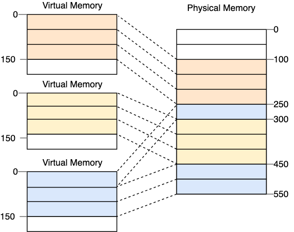
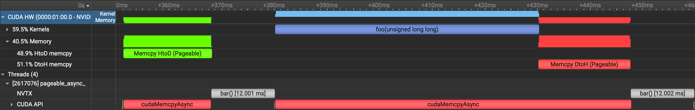
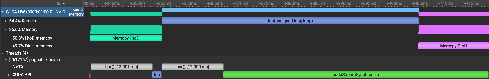
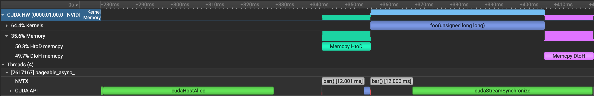

A collection of learnings I discovered over the course of [cudf#23457](https://github.com/rapidsai/cudf/pull/23457) — an optimization of pinned memory initialization times in [cuDF](https://docs.rapids.ai/api/cudf/stable/) — prefaced with the basics of pinned memory.

# 1) Pinned Memory: Who Cares?

## Setting the Stage

From a program's point of view, memory looks like a contiguous sequence of addresses. We request an arbitrary chunk of memory with `malloc(n)`, and the allocator will give us a buffer of `n` continuous memory addresses.

```cpp
unsigned char *p = malloc(5);
for (int i = 0; i < 5; ++i) printf((void *)(p))
// 0x1011fdba0 0x1011fdba1 0x1011fdba2 0x1011fdba3 0x1011fdba4
```

As one learns in an operating systems course, these are just *virtual addresses*, and their continuity is an illusion presented by the OS. Beneath this virtual address space, the operating system considers memory as a sequence of fixed-size chunks called *pages*. These virtual pages are mapped to *physical page frames* somewhere in RAM, which hold the actual bytes.


{caption: Virtual memory via paging ([source](https://os.phil-opp.com/paging-introduction/)).}

In other words, the buffer we got could span more than one page, and those pages could reside in entirely different physical locations.

This layer of indirection enables the OS to physically move pages as it sees fit — it may swap pages to disk to free up space, or migrate pages closer to a requesting CPU core — without disrupting the continuity of our program's virtual address space.

**Pinned memory** refers to pages that are **physically fixed to a page frame**[^pinned-vs-page-locked]. If memory is nearing capacity (see [swappiness](https://wiki.debian.org/swappiness)) and the swap daemon comes along to move lesser-used pages to disk, pinned memory will never be swapped out. This is great for latency: your process will never have to pay for a page fault when accessing pinned memory.

Of course, nothing in life is free. Memory is a scarce resource, and pinning memory tells the operating system, "I know better — I need this memory exactly where it is, so don't do anything clever in the name of resource efficiency." Pinning more memory than necessary can starve other processes (or the OS itself) of RAM.

That said, a suitable amount of pinned memory, used well, is a smart choice in some applications. In GPU applications, particularly, it is *necessary*.

## Dissecting DMA

> So why does pinned memory matter for GPUs?

Invariably, working with GPUs requires transferring data between the CPU and GPU. While this should be avoided as much as possible for performance reasons[^transfer-performance], there are usually boundaries[^transfer-boundaries] in most programs where it is compulsory.

Every framework has its own transfer APIs (`x.to(device)` in PyTorch, `jax.device_put(x, device)` in JAX). These generally all boil down to some form of `cudaMemcpy`:

```cpp
// Reserve and set some host memory.
int *h_arr = (int*)malloc(bytes);
memset(h_arr, 0, bytes);

// Reserve some device memory.
int *d_arr;
cudaMalloc((int**)&d_arr, bytes);

cudaMemcpy(d_arr, h_arr, bytes, cudaMemcpyHostToDevice);  // host -> device
foo<<<grid, block, 0>>>(d_arr);
cudaMemcpy(h_arr, d_arr, bytes, cudaMemcpyDeviceToHost);  // device -> host
```

Now, what's happening inside of `cudaMemcpy`?

The actual copying of bytes is performed by the GPU's [DMA (Direct Memory Access) engine](https://en.wikipedia.org/wiki/Direct_memory_access), which initiates the read instructions over PCIe. As its name implies, the DMA engine needs direct access to physical host memory — it is a peripheral device, not a standard OS process; therefore, it cannot use CPU virtual addresses, nor participate in the OS's virtual memory translation[^iommu].

Thus, the DMA engine takes a range of *physical bytes* on the host. You can start to imagine why it might be problematic if the host-resident bytes were in standard **pageable memory**, rather than pinned memory. What if you called:

```cpp
cudaMemcpy(d_arr, h_arr, bytes, cudaMemcpyHostToDevice);
  |
  dma_copy(dst_address=0x5678, src_address=0x1234, bytes=1000);
```

...and just after the DMA initiates the copy, the OS decides to swap or migrate the physical page containing `0x1234`? For a read, this might mean reading garbage (or worse, another process's memory); for a write, memory corruption.

To prevent these calamities, the host buffer *must be pinned* before a copy in either direction. The CUDA driver — running on your CPU[^driver-thread] — will do this for you by creating temporary, pinned staging buffers every time you make a copy. What really happens is this:

1. You call `cudaMemcpy(d_arr, h_arr, bytes, cudaMemcpyHostToDevice)`.
2. The CUDA driver obtains a pinned staging buffer `h_pinned` of length `bytes`.
3. The CUDA driver **copies** `h_arr` **from pageable memory to** `h_pinned`.
4. The CUDA driver queues a DMA copy from the physical address of `h_pinned` to the device address of `d_arr`.
5. The DMA engine performs the actual host-device copy.

The device-to-host direction proceeds similarly. So, there is an extra pageable-to-pinned copy happening under the hood with every `cudaMemcpy`, and the CUDA driver does it for you.

## Manual Pinning

> If the CUDA driver pins memory internally for me, why should I care?

The first reason is that, armed with knowledge of the internals, you can avoid the extra copy by making your host allocations *directly in pinned memory*. This is straightforward: instead of an ordinary `malloc`, you use [`cudaHostAlloc`](https://docs.nvidia.com/cuda/cuda-runtime-api/group__CUDART__MEMORY.html#group__CUDART__MEMORY_1gb65da58f444e7230d3322b6126bb4902):

```diff
- int *h_arr = (int*)malloc(bytes);
+ int *h_arr;
+ cudaHostAlloc((void**)&h_arr, bytes, cudaHostAllocDefault);
```

`cudaHostAlloc` gives you host memory that is already pinned under the hood[^cuda-malloc-host], hence making it safe for DMA access. That solves the extra-copy problem without much fuss: the subsequent `cudaMemcpy` needs no intermediate staging.

There is a second reason to pin memory manually with `cudaHostAlloc`, and that is **asynchrony**. Imagine you wish to use `cudaMemcpyAsync`, hoping to overlap the transfer latency with computation. Not knowing any better, you use a plain `malloc`:

```cpp
// Reserve and set some (pageable!) host memory.
int *h_arr = (int*)malloc(bytes);
memset(h_arr, 0, bytes);

// Reserve some device memory.
int *d_arr;
cudaMalloc((int**)&d_arr, bytes);

cudaMemcpyAsync(d_arr, h_arr, bytes, cudaMemcpyHostToDevice, stream);  // host -> device
bar(); // do CPU work while we wait.

foo<<<grid, block, 0, stream>>>(d_arr);

cudaMemcpyAsync(h_arr, d_arr, bytes, cudaMemcpyDeviceToHost, stream);  // device -> host
bar();  // do CPU work while we wait.

cudaStreamSynchronize(stream);
```

This code should:

1. Queue a copy from `h_arr` to `d_arr`.
   - While that completes, compute `bar()` on host.
2. Queue the `foo(d_arr)` kernel.
3. Queue a copy from `d_arr` back to `h_arr`.
   - While those complete, compute `bar()` on host.

For the copy to be asynchronous with respect to the host, it ought to return immediately, letting us run `bar()` right away. But with `h_arr` naively allocated in pageable memory, the calling thread is burdened with staging it into pinned memory — thus, the copies are *not actually asynchronous*. The [CUDA docs](https://docs.nvidia.com/cuda/cuda-runtime-api/api-sync-behavior.html#api-sync-behavior) confess this fact:

::: indent
"The API provides memcpy/memset functions in both synchronous and asynchronous forms, the latter having an 'Async' suffix. This is a misnomer as each function may exhibit synchronous or asynchronous behavior depending on the arguments passed to the function."
:::

Let's look at some traces to make this concrete, contrasting `malloc` with `cudaHostAlloc`.

### Pageable cudaMemcpyAsync

This is a trace[^profiling-setup] of the code directly above, which uses `malloc`:


{caption: Overlapping CPU work with cudaMemcpyAsync on pageable memory (doesn't work).}

The memcpys are effectively blocking: in each case, `bar()` can't run until the memcpy is complete, since the calling thread is busy staging buffers into pinned memory[^staging-pipeline]. This sequence took 96ms.

### Pinned cudaMemcpyAsync

This is a trace of the same code after swapping `malloc` for `cudaHostAlloc`:


{caption: Overlapping CPU work with cudaMemcpyAsync on pinned memory.}

Much better. Both calls are fully asynchronous: the first `bar()` begins as soon as the first memcpy is enqueued, and the second begins as soon as the kernel and second memcpy are enqueued, since the calling thread does not need to participate in the copies. This sequence took 78ms, about 20% faster.

# 2) Pinned Memory: Faster Initialization

> But what's the latency of cudaHostAlloc itself?

Let's get a zoomed out view of the second trace.


{caption: cudaMemcpyAsync with cudaHostAlloc, including allocation time.}

Problem: `cudaHostAlloc` is slow. For our 256MB buffer, it took 50ms, effectively undoing the benefits of asynchrony we observed in our toy example.

In a real application, you might allocate a much larger pinned buffer in one `cudaHostAlloc` — e.g., 8-16GB — and suballocate from that single pool for all host-device transfers during the application[^rmm-behavior]. Here's a sense of initialization times at larger scales (measured on a [g6.4xlarge](https://aws.amazon.com/ec2/instance-types/g6/)):

Pool size | cudaHostAlloc Time
-- | --
1 GiB | 0.49 s
2 GiB | 0.99 s
4 GiB | 2.0 s
8 GiB | 3.9 s
16 GiB | 7.9 s

Is this a problem? If your application is hours long, probably not — who cares about a few seconds of initialization time. But if it runs for less than a minute (serving a real-time use case, for instance), initializing pinned memory could make a 10% dent in your latency. Or if your app uses autoscaling — i.e., dynamically spins up and down processes — you might be paying this cost hundreds of times. In these scenarios, you might really start to care about startup costs.

## Inside cudaHostAlloc

> So what is cudaHostAlloc actually doing?

`cudaHostAlloc` needs to return `n` bytes of pinned memory. That procedure looks something like this[^cuda-caveat]:

1. Ask for a virtual address range of size `n`, e.g. via `malloc` or `mmap`.
2. Tell the OS to pin each page in the range, e.g. via [`pin_user_pages()`](https://docs.kernel.org/core-api/pin_user_pages.html).
3. Write down the physical page locations in an internal data structure (which essentially says, "these pages are ready for DMA.")

Let's take a closer look at step (2). `pin_user_pages()` walks the range and invokes a page fault to back each virtual page with a physical page frame. This is because a virtual address range returned by `malloc` or `mmap` may not have any physical backing, due to [demand paging](https://en.wikipedia.org/wiki/Demand_paging): pages are backed lazily. That is generally good for efficiency, but pinned memory — by definition — needs to be *physically fixed to a page frame* in order to be pinned.

Lazily backing pages is generally good for efficiency, but it is not sufficient for pinned memory. After all, pinned memory : it needs a physical backing. Thus, `cudaHostAlloc` performs a few extra steps:

1. Back the `n`-byte virtual address range with physical pages.
2. Tell the OS to pin the pages.
3. Register the physical pages to an internal data structure in the CUDA driver  
  (which essentially says, "these pages are ready for DMA.")

We can see this happening in the open-source CUDA driver:

[^pinned-vs-page-locked]: There is a related notion called 'page-locked' (see [mlock](https://man7.org/linux/man-pages/man2/mlock.2.html)), where the OS guarantees that the page is resident in a page frame, but can still move the page around. If your page is page-locked but not pinned, you might still pay for a '[soft page fault](https://lwn.net/Articles/600502/)', where the new location of a migrated page must be found and remembered. Pinning, in contrast, fixes the page in place. Unfortunately, the [CUDA docs](https://docs.nvidia.com/cuda/cuda-programming-guide/02-basics/understanding-memory.html#page-locked-host-memory) use 'page-locked' and 'pinned' interchangeably; for our purposes, they really mean 'pinned'.

[^transfer-performance]: Mark Harris has a great [blog](https://developer.nvidia.com/blog/how-optimize-data-transfers-cuda-cc/) on the performance analysis of these data transfers.

[^transfer-boundaries]: E.g., a data loader or preprocessor that feeds a GPU training pipeline, printing the result of some inference task, or fetching data from local or remote storage (barring fancy stuff like [GPU Direct Storage](https://docs.nvidia.com/gpudirect-storage/)).

[^iommu]: In some cases an [IOMMU](https://en.wikipedia.org/wiki/Input%E2%80%93output_memory_management_unit) interposes between the DMA engine and host memory, mapping device-visible virtual addresses (called IOVAs) to physical addresses on the host. Regardless, the DMA still needs stable physical host addresses underneath that mapping.

[^driver-thread]: More specifically, CUDA driver code (`libcudart.so`) typically runs inline on the calling thread.

[^cuda-malloc-host]: The older [`cudaMallocHost`](https://docs.nvidia.com/cuda/cuda-runtime-api/group__CUDART__MEMORY.html#group__CUDART__MEMORY_1gab84100ae1fa1b12eaca660207ef585b) does the same.

[^profiling-setup]: Profiled with [nsys]("https://developer.nvidia.com/nsight-systems"). I implemented foo() and bar() as busy loops lasting ~50ms and ~12ms respectively, and ran this on a 256MB buffer. I added [NVTX ranges](https://archive.docs.nvidia.com/nsight-visual-studio-edition/2020.1/nvtx/index.html) around the calls to bar().

[^staging-pipeline]: One might wonder why `bar()` has to wait for the *entire* memcpy: can't it run once the thread is done copying to pinned, and at least overlap with the DMA? Internally, `HtoD` isn't actually *one* pinned copy followed by *one* DMA. It is typically implemented with two buffers, where the calling thread fills one and the DMA engine drains the other, pipelined in chunks (see Nicholas Wilt's [CUDA handbook](https://www.cudahandbook.com/book/ch6/asynchronous-memcpy) for a visual). Hence `bar()` must wait until the calling thread has staged the very last chunk (resulting in a tiny bit of overlap with the final DMA, if you look *very* closely). The `DtoH`, on the other hand, has no overlap whatsoever, since the calling thread has the final action of copying the last chunk back to pageable memory (where the memory began) to complete the transfer.

[^rmm-behavior]: This is what [RMM](https://github.com/rapidsai/rmm)'s pinned memory resource does, which is used by cuDF.

[^cuda-caveat]: Note that the explanation here is all an educated guess, since the CUDA user mode driver is not open source. But benchmarks, along with other hints (like looking at call stacks, inspecting `/proc/self/maps` for memory mapping metadata, and `getrusage()` to count page faults) substantiate the guess.
